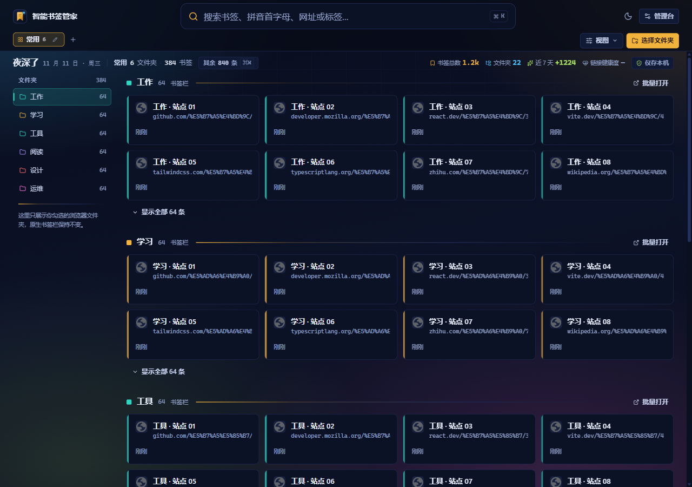
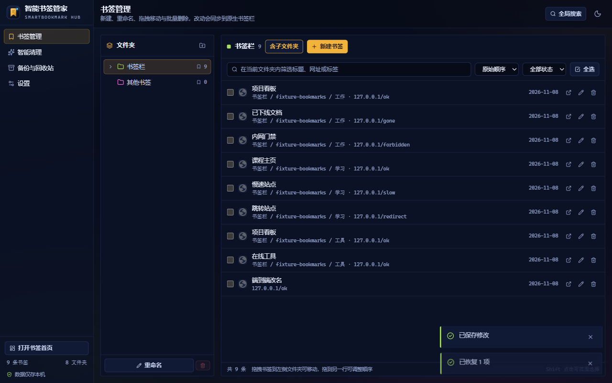
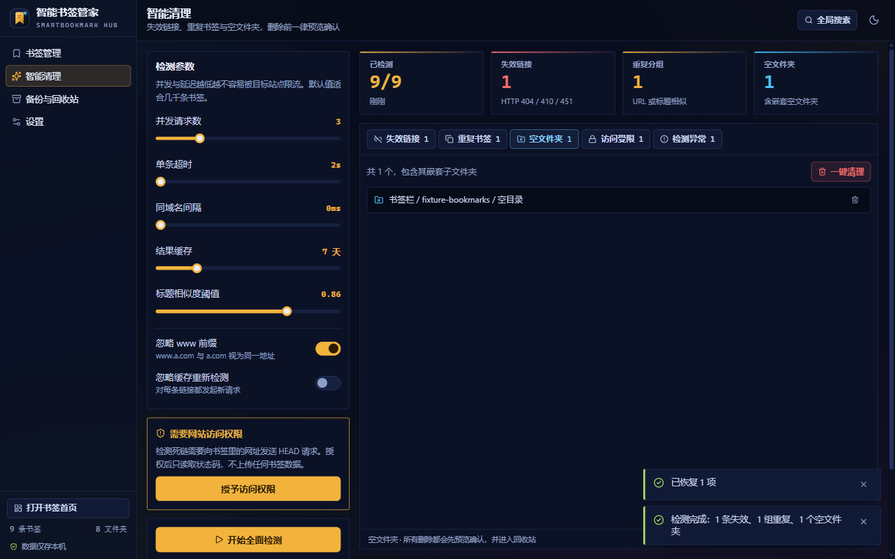
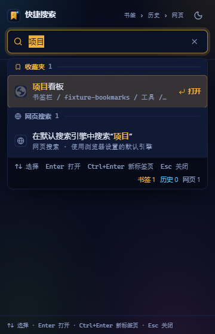

<div align="center">


# SmartBookmark Hub

**书签优先的全局搜索 · 可视化首页 · 书签智能治理**

一个完全本地化的 Chrome 扩展（Manifest V3）。在**不改动 Chrome 原生收藏夹**的前提下，让上万条书签变得可浏览、可搜索、可治理。

[](https://github.com/taoweidong/smartbookmark-hub/actions/workflows/ci.yml)
[](LICENSE)
[](docs/SmartBookmark-Hub-技术方案.md)
[](src)
[](package.json)
[](https://github.com/taoweidong/smartbookmark-hub/pulls)

[功能](#-功能) · [安装](#-安装) · [使用](#-使用) · [开发](#-开发) · [参与贡献](#-参与贡献) · [隐私](#-隐私)

</div>

---

| 首页 | 书签管理 |
|---|---|
|  |  |
| **智能清理** | **快捷搜索弹窗** |
|  |  |

## ✨ 功能

- **🏠 可视化首页**（接管新标签页）
  按你勾选的原生文件夹分区展示书签卡片；多页签（工作 / 学习 / 娱乐…）独立配置文件夹；网格 / 列表布局、三档卡片尺寸、四色主题强调、亮暗模式与自定义背景收进可折叠视图栏（展开态记忆），「选择文件夹」恒可见；问候、日期、页签摘要与书签总数 / 近 7 天新增 / 链接健康度合并为单行概览，首屏优先留给书签内容。

- **🔎 书签优先的全局搜索**
  三个入口共用同一引擎：地址栏关键字 `bm`、页面内搜索胶囊（`Ctrl/⌘ + K`）、工具栏弹窗。排序恒定 **书签 → 历史 → 网页**，支持中文、拼音首字母（`zh` → 知乎）、全拼（`zhifu`）、URL 片段与标签模糊匹配；↑↓ 选择、Enter 新标签页打开、Esc 关闭；地址栏回车项按 scheme 识别：可导航 scheme（http/https/chrome/file/ftp/about 等）直接打开，其余自由文本交给浏览器默认搜索引擎兜底。

- **🗂 书签管理台**
  树形浏览、新建 / 重命名 / 拖拽移动（拖到文件夹移动、拖到行内调序）、Shift 范围批量选择、标签管理、按链接状态筛选——所有改动实时同步到 Chrome 原生书签栏。

- **🧹 智能清理（绝不静默删除）**
  - **死链检测**：可配并发数 / 超时 / 同域名节流；HEAD → GET 自动回退；404/410/451 判死，403/429/503 单列「访问受限」防误删；结果按域名缓存，支持断点续扫
  - **重复合并**：URL 归一化（剔除 `utm_*` 等跟踪参数、可选忽略 `www`）+ 标题 bigram 相似度
  - **空文件夹**：含嵌套空链检测
  - 全部经「预览 → 确认 → 回收站 → Toast 撤销（8s）」链路，最近 20 批可随时恢复

- **💾 备份与迁移**
  标准 Netscape HTML 导出（可被 Chrome 原生书签管理器直接导入）、HTML 导入（白名单解析、强制导入到独立文件夹不覆盖现有数据）、JSON 全量备份。

## 📥 安装

### 从源码加载（当前发布方式）

```bash
git clone https://github.com/taoweidong/smartbookmark-hub.git
cd smartbookmark-hub
npm install
npm run build          # 产物输出到 dist/
```

然后在 Chrome 中：打开 `chrome://extensions` → 开启右上角 **开发者模式** → **加载已解压的扩展程序** → 选择 `dist` 目录。

### 网页预览（不装扩展）

```bash
npm install
npm run dev            # Vite 开发服务器，内置示例书签（Demo 模式）
```

## 🕹 使用

| 操作 | 快捷键 |
|---|---|
| 打开书签首页 | `Ctrl + Shift + K` |
| 书签优先快速搜索 | `Ctrl + Shift + F` |
| 地址栏搜索书签 | 输入 `bm` + 空格 + 关键词 |
| 聚焦页面内搜索 | `Ctrl/⌘ + K` |
| 结果上下选择 / 新标签页打开 / 关闭 | `↑↓` / `Enter` / `Esc` |

> 首次使用：打开首页 → 点「选择文件夹」勾选想展示的文件夹 → 保存到页签。新标签页接管如需恢复，可在 Chrome 提示条中关闭接管，本扩展所有页面仍可正常访问。

## 🛠 开发

```bash
npm install            # Node 20+，无需额外全局依赖
npm run dev            # 网页预览（Demo 数据）
npm run build          # 构建扩展产物到 dist/
npm run typecheck      # TypeScript 严格类型检查
npm run test           # Vitest 单元 + 组件测试（533 例）
npm run test:coverage  # Vitest 覆盖率报告（v8，输出 coverage/）
npm run e2e            # Playwright 驱动真实 Chromium 的端到端验证（52 项断言）
npm run package        # 打包 dist/ 为 zip
npm run icons          # 重新生成品牌图标
```

> E2E 首次运行需 `npx playwright install chromium`。品牌版 Chrome 自 M137 起忽略 `--load-extension`，脚本会自动使用 Playwright 自带的 Chromium。

### 架构

三层分离，核心逻辑与平台彻底解耦：

```
┌─────────────────────────────────────────────────┐
│ 页面层  newtab / popup / options（React 19）      │  只调用 core，不直接碰 chrome.*
├─────────────────────────────────────────────────┤
│ 核心层  src/core（纯 TS，无 DOM/React 依赖）       │  搜索 / URL 归一化 / 拼音 / 并发池
│                                                 │  死链 / 去重 / 空文件夹 / 回收站 / 备份
├─────────────────────────────────────────────────┤
│ 适配层  src/core/backend.ts（唯一 chrome.* 边界） │  ChromeBackend ⇄ DemoBackend 自动降级
└─────────────────────────────────────────────────┘
```

- **搜索**：内存倒排式全量打分（万级书签 < 30ms），拼音结果按标题缓存，输入防抖 300ms
- **长任务**：扫描只跑在页面上下文（规避 MV3 Service Worker 30s 生命周期），每 25 条落盘 IndexedDB，可断点续扫
- **存储**：设置存 `chrome.storage.local`，大对象（健康缓存 / 扫描报告 / 回收站）存 IndexedDB
- **构建**：Vite 多入口，`background.js` 固定输出路径与 manifest 精确对应

详细设计与决策依据见 [docs/SmartBookmark-Hub-技术方案.md](docs/SmartBookmark-Hub-技术方案.md)，任务分解见 [docs/实施计划.md](docs/实施计划.md)。

## 🤝 参与贡献

欢迎 Issue 与 PR！

1. Fork 并创建分支：`git checkout -b feat/my-feature`
2. 提交信息使用中文前缀：`feat: ` / `fix: ` / `test: ` / `chore: ` / `docs: `
3. 确保 `npm run typecheck && npm run test` 通过，涉及 UI 的改动请补充 `npm run e2e`
4. 发起 Pull Request，描述清楚动机与改动范围

提交 Bug 时请附：Chrome 版本、复现步骤、控制台报错（如有）。

## 🔒 隐私

- 书签、标签、设置、扫描结果、回收站**全部仅存本机**（`chrome.storage.local` + 扩展自有 IndexedDB）
- 无 analytics、无远程代码、无远程字体、无任何 telemetry
- 唯一的网络请求：① 用户主动触发的死链检测（目标即书签自身 URL，需按需授予站点访问权限，可随时在设置中撤回）；② 用户自定义背景图；③ 用户主动执行的网页搜索（交给浏览器默认引擎）

## 📄 许可证

[MIT](LICENSE) © 2026 taoweidong

## 🙏 致谢

依托以下优秀的开源项目构建：

[React](https://react.dev) · [Vite](https://vite.dev) · [Tailwind CSS](https://tailwindcss.com) · [zustand](https://github.com/pmndrs/zustand) · [pinyin-pro](https://github.com/zh-lx/pinyin-pro) · [idb-keyval](https://github.com/jakearchibald/idb-keyval) · [TanStack Virtual](https://tanstack.com/virtual) · [lucide-react](https://lucide.dev) · [Vitest](https://vitest.dev) · [Playwright](https://playwright.dev)
